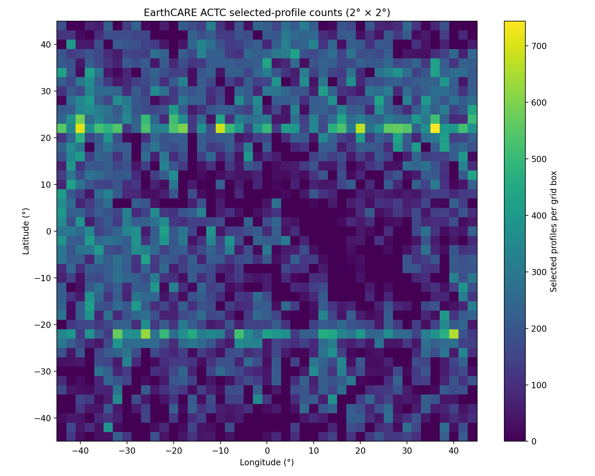

## Selected EarthCARE Profiles

This folder contains an example csv of 200 outputs for a request of scenes inside the -45, 45 lat, lon bbox of FCI and the indices that correspond to parts of the ACTC curtain where no "other" pixels are identified.

The files are from 15/09 - 1/10/2026 and they are only day files. The solar zenith angle has not been calculated. The spatial extent is seen in the following figure.

